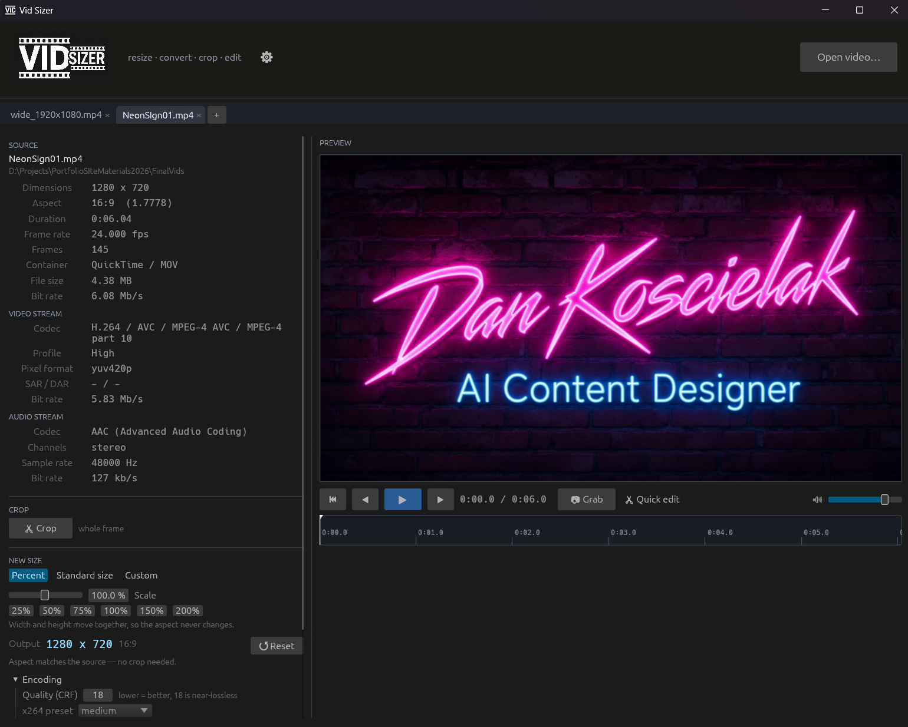
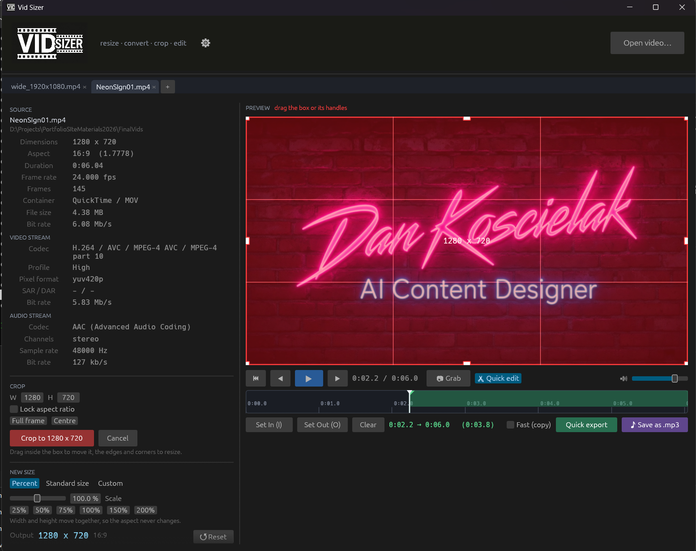
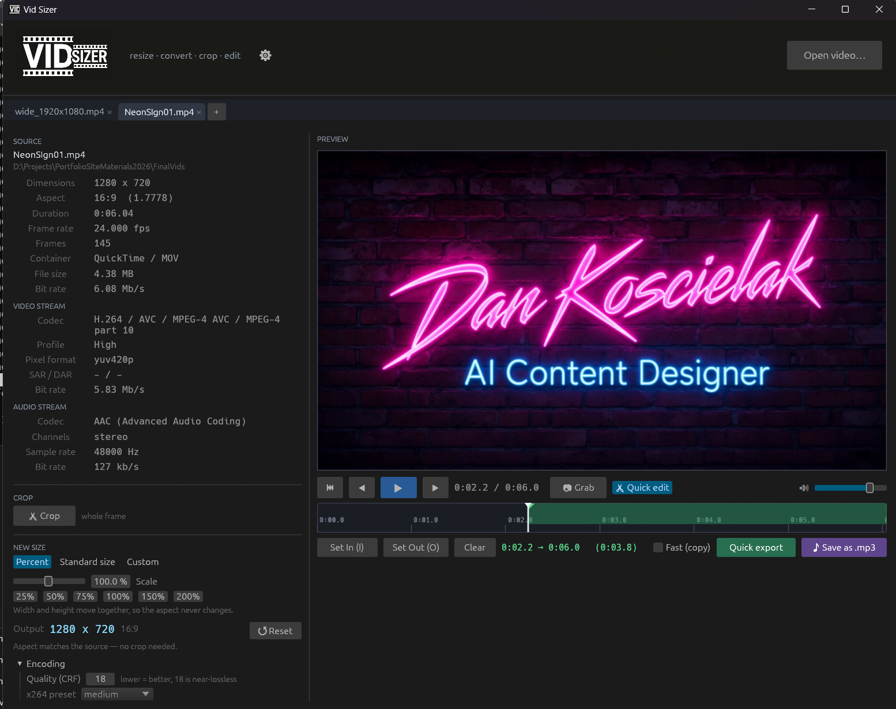

# Vid Sizer

A small Windows app for resizing, converting, cropping and trimming video.
Drag a file in, see everything about it, pick a new size, drag a crop box if you
need one, render. The result lands next to the original with the new dimensions
in the name.

```
clip.mp4  ->  clip_1920x1080.mp4
```

No install, no account, no cloud. It is one executable that drives ffmpeg.



---

## Download

| | |
|---|---|
| **[All-in-one](https://github.com/DeeKozman/vid-sizer/releases/latest/download/VidSizer-windows-all-in-one.zip)** — 270 MB | Everything included. Unzip, run **Vid Sizer.exe**. Nothing else to install. |
| **[App only](https://github.com/DeeKozman/vid-sizer/releases/latest/download/VidSizer-windows.zip)** — 16 MB | For people who already have ffmpeg on their PATH. |

Unzip anywhere — your Desktop, a tools folder, a USB stick. Nothing is written
to the registry and there is no uninstaller to run; delete the folder and it is
gone.

Windows SmartScreen will warn you on first run, because the exe is not code
signed. **More info → Run anyway.**

### Which one do I want?

If you are not sure whether you have ffmpeg, take the all-in-one. It carries its
own copy in an `ffmpeg\bin` subfolder and uses that in preference to anything
else on the machine, so it cannot pick a fight with an ffmpeg you already have.

If you do have ffmpeg on your PATH, the app-only download is 16 MB and will find
it. It looks in this order:

1. `ffmpeg.exe` / `ffprobe.exe` next to the app, or in `ffmpeg\bin` beside it
2. `C:\ffmpeg\bin`, `C:\Program Files\ffmpeg\bin`
3. anywhere on `PATH`

If it finds neither, it says so on startup rather than failing later.

---

## What it does

### Tells you what you have

Drop a file and the left column fills in: dimensions, aspect, duration, frame
rate, frame count, container, file size and bit rate, then the video stream
(codec, profile, pixel format, SAR/DAR) and the audio stream (codec, channel
layout, sample rate, bit rate).

Rotation metadata is respected. A phone clip stored as 1920x1080 with a 90°
rotation flag is reported, previewed and resized as 1080x1920 — which is what
you actually get out.

### Three ways to set the size

- **Percent** — one slider drives width and height together, so the aspect never
  changes. Quick buttons for 25 / 50 / 75 / 100 / 150 / 200%.
- **Standard size** — 4K UHD, 1440p, 1080p, 720p, 480p, 360p, vertical 9:16 at
  two sizes, square 1:1, portrait 4:5, and 2.39:1 scope.
- **Custom** — type an exact width and height, with an aspect lock you can
  switch off.

Every dimension is snapped to an even number, because H.264 with 4:2:0 chroma
cannot encode odd ones.

### Crop



The **Crop** button opens a box over the picture with eight handles, everything
outside it dimmed. Drag inside to move it, the edges and corners to resize.
**Lock aspect ratio** holds the shape it has at that moment, or type an exact
width and height.

Applying a crop sets the output size to the crop's own pixels, so nothing is
resampled. Percent, Standard size and Custom will then scale that cropped region
if you want them to.

There is a shortcut for the common case: with no manual crop, picking a preset
whose aspect does not match the source auto-arms a max-size box of the target
aspect that you slide into place. Turning a 16:9 clip into a 9:16 vertical is two
clicks and a drag.

The crop always runs before the scale, so only the pixels you keep get resampled.

### Play it

The preview is a real player, not a still: play/pause, a scrub bar, frame
stepping and volume, with the audio in sync. The crop box stays live on top while
it plays, so you can scrub to a moment that actually represents the shot and
frame against motion instead of against whatever happened to be on frame one.

The timeline has round-number ticks with timecodes, click or drag anywhere to
move the playhead, and zooms with `+` / `-` or the scroll wheel.

### Grab stills

**📷 Grab** writes the frame under the playhead at full source resolution into a
folder named after the clip, beside it:

```
D:\clips\Holiday Reel.mp4
D:\clips\Holiday Reel\Holiday_Reel_00-01-23-456.png
```

The name is the clip name plus a fixed-width `HH-MM-SS-mmm` timecode, so sorting
the folder by name puts the stills in timeline order. It depends only on *where*
you are in the video, never on when you pressed the button — so grabbing the same
moment twice replaces the file instead of leaving you with near-duplicates.

### Trim, and rip the audio



**✂ Quick edit** adds in and out markers — set them with the buttons or `I` and
`O`. They draw as flags on the timeline with the selected range tinted.

- **Quick export** writes only that range, re-encoding with the current size and
  crop so the cut is frame-accurate. Tick **Fast (copy)** to remux instead: near
  instant at any length, but the cut lands on the nearest keyframe and the resize
  and crop are skipped.
- **♪ Save as .mp3** rips the audio at 320 kbps — the marked range if there is
  one, otherwise the whole track.

### Several files at once

Every video you drop opens in its own tab, each with its own crop, size, markers
and render job. A render started on one tab keeps running while you work on
another. You can also pass files on the command line, so "Open with" and dragging
files onto the exe both work.

### Output

Always written next to the source as `<name>_<width>x<height>.<ext>`. If that
name is taken it becomes `_2`, `_3`, so a second render never clobbers the first.
The source extension is kept, except WebM and OGV, which become MP4 because
libx264 cannot go into those containers.

Encoding is libx264 at CRF 18 — near-lossless — with the audio stream copied
untouched. Both are adjustable, along with the x264 speed preset, and there is a
box that shows the exact ffmpeg command if you want to see or copy it.

Progress comes from ffmpeg itself. Cancel kills the process and deletes the
half-written file.

---

## Keyboard

| Key | Does |
|-----|------|
| `2` or `Space` | Play / pause |
| `1` or `←` | Back one frame |
| `3` or `→` | Forward one frame |
| `Home` | Back to the start |
| `+` / `-` | Zoom the timeline in / out |
| `I` / `O` | Set the in / out marker |
| `C` | Grab the current frame |
| `Ctrl + Tab` | Next tab (with `Shift`, the previous one) |
| `Ctrl + W` | Close the current tab |

The ⚙ gear in the header lists all of this, plus the mouse gestures.

---

## Building it yourself

Needs a Rust toolchain and, on Windows, the MSVC build tools.

```bash
cargo build --release
```

Out comes a single `target\release\vid-sizer.exe`, about 16 MB, with no console
window and no DLLs beside it.

`install.ps1` goes further: it builds, copies the exe to a folder outside
`target\` (which `cargo clean` would wipe), puts ffmpeg in an `ffmpeg\bin`
subfolder, and makes desktop and Start menu shortcuts.

```powershell
powershell -ExecutionPolicy Bypass -File install.ps1
```

`-Dest <path>` installs elsewhere, `-NoFfmpeg` skips the ffmpeg copy, `-NoBuild`
only deploys what is already built.

### Tests

The geometry and naming are unit-tested and need no setup:

```bash
cargo test
```

There is a second set that shells out to the real ffmpeg and checks the files it
writes. Those need fixtures, so they are `#[ignore]`d:

```powershell
powershell -File make_fixtures.ps1
$env:VIDSIZER_FIXTURES = "$env:TEMP\vid-sizer-fixtures"
cargo test -- --ignored --test-threads=1
```

They cover probing a real file, percent resizes landing on the right filename and
dimensions, both crop directions, trimmed exports really being the marked length,
screenshots being full resolution on a deterministic path, mp3 rips containing no
video, and the player's clock advancing while playing and freezing on pause.

---

## How it works

Rust, with [egui](https://github.com/emilk/egui) for the interface. ffmpeg and
ffprobe are driven as child processes rather than linked as libraries, which
keeps the build simple and means you can swap the ffmpeg build without
recompiling anything.

Playback is two ffmpeg processes started from the same timestamp: one piping raw
RGBA frames, the other raw f32 PCM resampled to the output device's rate.
**Audio is the master clock** — the count of sample frames handed to the sound
card *is* the playback position — and video frames are shown as their timestamps
come due, with late ones dropped. A clip with no audio falls back to wall time.
Seeking tears both processes down and restarts them, bumping a generation counter
so frames still in flight are discarded.

| File | What's in it |
|------|--------------|
| `src/main.rs` | Entry point: window options, command-line files |
| `src/app.rs` | The shell: header, tab strip, options dialog, input routing |
| `src/doc.rs` | One open video — settings, crop tool, preview, transport |
| `src/probe.rs` | ffprobe JSON into `MediaInfo`, including rotation |
| `src/sizing.rs` | Presets, even-number snapping, crop geometry, output naming |
| `src/job.rs` | Building the ffmpeg command, running it, progress, screenshots |
| `src/player.rs` | Playback: frame and PCM decoding, the audio clock, seeking |
| `src/ffmpeg.rs` | Finding ffmpeg/ffprobe, launching without a console flash |
| `src/logo.rs` | Decoding the logo for the header and window icon |
| `src/ui.rs` | Shared palette and small widgets |

---

## Known limits

- Windows only. Nothing in it is deeply Windows-specific except the console-window
  suppression and the install script, but it has only ever been built and run there.
- Renders are one per tab; there is no queue that works through them in turn.
- Output is always libx264. NVENC would be a small addition.
- The exe is not code signed, so SmartScreen warns on first run.

---

## Licence

The app is MIT licensed — see [LICENSE](LICENSE).

The all-in-one download also contains ffmpeg and ffprobe binaries, which are
**not** covered by that licence. They are a GPL v3 build from
[gyan.dev](https://www.gyan.dev/ffmpeg/builds/); their licence travels with them
in `ffmpeg\LICENSE.txt` and the source is at
[ffmpeg.org](https://ffmpeg.org/download.html). The app-only download contains no
ffmpeg code at all.

Built by [Dan Koscielak](https://kozalakstudio.com).
